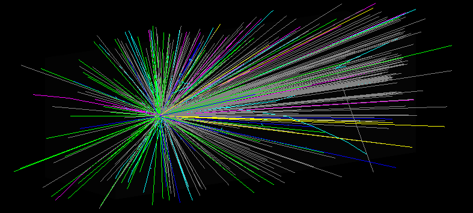

# Janus

Janus is a from-scratch particle-production and beam-transport research code inspired by the antimatter production pipeline. It focuses on modeling particle production at a target and the subsequent transport of charged particles through magnetic beamlines.

> **Status:** Archived research snapshot. The repository contains the latest handwritten transport implementation from the project's history, its validation framework, and archived validation figures. No further development is planned.

## What Janus implements



- **Collision:** a C++ Geant4 engine simulates proton bombardment of a high-Z target and records secondary-particle phase space.
- **Transport:** Python code advances charged particles under the relativistic Lorentz force using a staggered relativistic Boris scheme. Janus defines drift, dipole, quadrupole, and magnetic-horn fields and aperture losses.
- **Validation:** a configurable framework compares single-particle trajectories, conserved quantities, timestep convergence, composite lattices, beam properties, and linear-optics quantities with analytical or numerical references.

The transport pipeline is implemented in Janus; Geant4 supplies the interaction model. The handwritten tracker is a classical prescribed-field model, not a self-consistent plasma or Maxwell solver.

## Geant4 Python API

The `Simulation` API configures and runs the Geant4 engine. It loads `collision/config.json` by default; you can provide another JSON config path. Configuration is also available through Python attributes:

```python
from collision.interface import Simulation

sim = Simulation()
sim.load_config("collision/config.json")
sim.beam.count = 100_000
sim.beam.profile = "Gaussian"
sim.beam.sigma = "0.5 mm"
sim.beam.energy_dist = "Mono"
sim.beam.energy_mean = "26 GeV"
sim.run()
```

`Simulation` exposes `beam` and `environment` settings, plus output and run options such as `record_mode`, `physics_list`, `seed`, and `threads`. Call `load_config(path)` first to apply a JSON configuration, then override any settings in Python before calling `run()`. The Geant4 executable must be built first; see the [installation guide](docs/guides/geant4_installation.md).

## Run collision and transport

From the repository root, after building the Geant4 engine and installing Python dependencies:

```bash
# Generate and package collision output under data/collision/
python collision/run.py

# Track the configured antiproton seed through the dipole lattice.
# This case reads the newest simulation.root from data/collision/ and filters it.
python transport/main.py --experiment transport/experiment/configs/dipole.yaml
```

The Geant4-backed transport case needs a collision `simulation.root` containing antiproton seeds in the reader's configured momentum range. To run transport without Geant4 output, use the self-contained FODO case:

```bash
python transport/main.py --experiment transport/experiment/configs/fodo.yaml
```

## Transport validation

The archived campaign covers the Boris integrator and individual elements, composite drift–magnet systems, FODO transport, beam-level observables, and numerical linear optics. The study descriptions, criteria, numerical results, and plots are collected in [transport validation](docs/validation/transport_validation.md). The figures are historical outputs from the development campaign, not a fresh run performed during this restoration.

## Run a validation case

Install the dependencies, then run a YAML case from the repository root:

```bash
python -m pip install -r requirements.txt
python transport/main.py --experiment transport/experiment/configs/fodo.yaml
```

The run writes reports and figures to the case's configured output directory. The `transport/experiment/configs/` directory contains additional drift, dipole, quadrupole, horn, and composite cases. Geant4-seeded runs require a `Seeds` tree written by a collision simulation; analytical and Gaussian-beam validation cases do not require Geant4.

The interactive 3D viewer is optional and requires VisPy plus a supported GUI backend. The core Boris transport and validation path does not require it.

## Project structure

```text
engine/                         C++ Geant4 collision engine
collision/                      Collision orchestration and validation
transport/physics/              Relativistic Boris integrator and particle data
transport/lattice/              Handwritten magnetic fields and beamline elements
transport/validation/           Metrics, references, convergence, reports, and plots
transport/experiment/configs/   Reproducible validation configurations
docs/validation/                Collision and transport validation records
docs/assets/transport_stage/    Archived transport validation figures
```

See [architecture](docs/ARCHITECTURE.md), [physics](docs/PHYSICS.md), the [transport validation record](docs/validation/transport_validation.md), [collision validation](docs/validation/collision_validation.md), and the [Geant4 installation guide](docs/guides/geant4_installation.md).

## Acknowledgements

The collision engine uses [Geant4](https://geant4.web.cern.ch/). Janus's transport integrator and magnetic-element fields are implemented in this repository.
