# Transport Validation

This document records the Janus transport validation campaign for the relativistic particle integrator, lattice elements, and multi-element beam transport. The numerical values and figures are historical results from development; they were not regenerated during restoration of the handwritten implementation to `main`.

Figures from the campaign are archived in `docs/assets/transport_stage/`. Run-generated reports and figures are written to the configured output directory and are not committed here.

---

# 1. Introduction

## Purpose

Janus advances charged particles through user-defined electromagnetic lattices by integrating the relativistic Lorentz force. Validation asks whether that integration — and the magnets that source the fields — reproduce known accelerator physics before the same machinery is used for design or optimization.

## Hierarchical philosophy

Validation progresses deliberately:

| Stage | Question |
|-------|----------|
| Single particle | Does the Boris integrator solve the Lorentz equation correctly in elementary fields? |
| Composite transport | Do validated elements remain consistent when joined? |
| Beam transport | Does an ensemble evolve as expected under linear optics? |
| Linear optics benchmarking | Does Janus agree with established first-order optics? |

Each stage assumes the previous one. Independent validation at every level is required: optimization against a broken integrator, or Twiss matching on an untested lattice stack, would only tune numerical artefacts.

## Why this matters for later Janus stages

A credible foundation for antimatter transport, deceleration, cooling, trapping, and ultimately a digital twin of the beamline requires that:

1. the **physics implementation** (fields + Lorentz force) is correct;
2. **composite beamlines** preserve physical invariants across element boundaries;
3. **beam observables** (envelope, emittance, Twiss) behave as accelerator physics predicts.

The sections below address those three requirements in order.

---

# 2. Numerical Integrator Validation

**Goal.** Validate the Boris integrator and Lorentz-force implementation for isolated lattice elements against analytical or paraxial references, while monitoring relativistic conservation.

Particles obey

$$
\frac{d\mathbf{p}}{dt}=q\bigl(\mathbf{E}+\mathbf{v}\times\mathbf{B}\bigr),\qquad \mathbf{p}=\gamma m\mathbf{v}.
$$

A case passes when trajectory metrics meet declared tolerances and relative momentum and energy drifts remain below $10^{-6}$.

---

## Uniform Drift

**Physical quantity.** Field-free straight-line transport: position, velocity, $|p|$, and $\gamma$.

**Expectation.** With $\mathbf{E}=\mathbf{B}=\mathbf{0}$, motion is $\mathbf{r}(t)=\mathbf{r}_0+\mathbf{v}_0 t$. Momentum and energy are exactly conserved.

**Methodology.** A single Geant4 proton is tracked through a long drift. Numerical coordinates are compared to the closed-form trajectory at every step; maximum relative $|p|$ and $\gamma$ drifts are recorded.

**Results.**

| Quantity | Result | Criterion |
|----------|--------|-----------|
| $x$ error | $4.0\times10^{-15}\,\mathrm{m}$ | $\le 10^{-6}\,\mathrm{m}$ |
| $y$ error | $6.2\times10^{-15}\,\mathrm{m}$ | $\le 10^{-6}\,\mathrm{m}$ |
| $z$ error | $1.5\times10^{-13}\,\mathrm{m}$ | $\le 10^{-6}\,\mathrm{m}$ |
| Momentum conservation | $0$ | $\le 10^{-6}$ |
| Energy conservation | $0$ | $\le 10^{-6}$ |

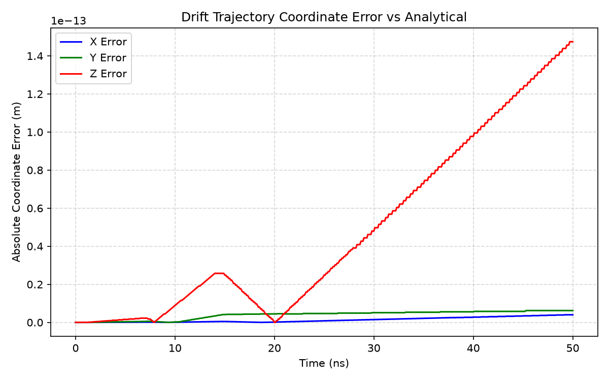
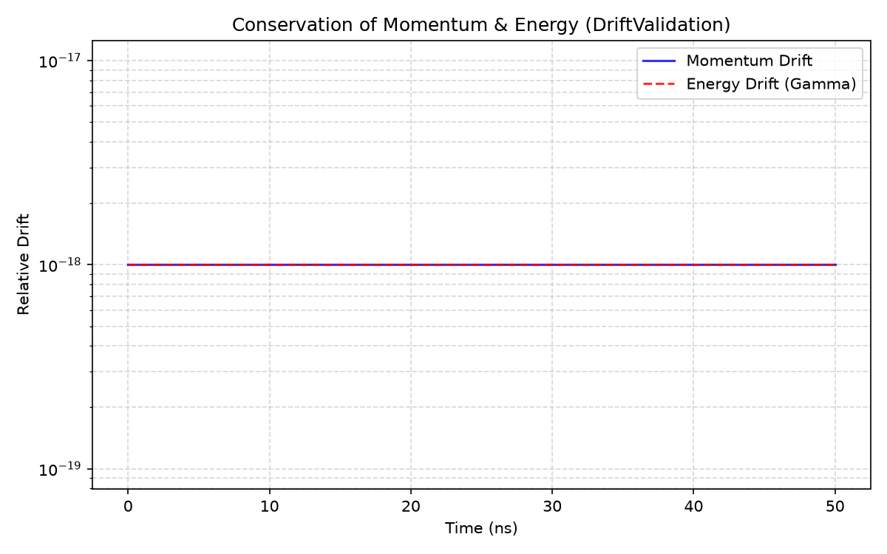

**Interpretation.** Coordinate errors at floating-point scale show that the integrator does not invent forces in vacuum. Flat conservation traces confirm that the Boris update introduces no spurious heating or momentum exchange. Residual $\sim10^{-13}\,\mathrm{m}$ differences are accumulation artefacts between leapfrog stepping and the closed-form reference, far below any physical tolerance.

---

## Uniform Dipole

**Physical quantity.** Magnetic bending: cyclotron radius, bend angle, and the curved orbit in a uniform $B_y$.

**Expectation.** For rigidity $B\rho$ and field $B_y$,

$$
R=\frac{p_\perp}{|q|B_y},\qquad \theta=\frac{q B_y L}{p}.
$$

The orbit is a circular arc; $|p|$ and $\gamma$ remain constant in a static magnetic field.

**Methodology.** A single antiproton is tracked through a long uniform dipole. Cyclotron-radius and bend-angle errors are compared to the analytical orbit; conservation is monitored throughout.

**Results.**

| Quantity | Result | Criterion |
|----------|--------|-----------|
| Cyclotron radius error | $1.9\times10^{-7}$ | $\le 10^{-4}$ |
| Bend angle error | $4.6\times10^{-3}$ | $\le 10^{-2}$ |
| Momentum conservation | $9.5\times10^{-15}$ | $\le 10^{-6}$ |
| Energy conservation | $8.9\times10^{-15}$ | $\le 10^{-6}$ |

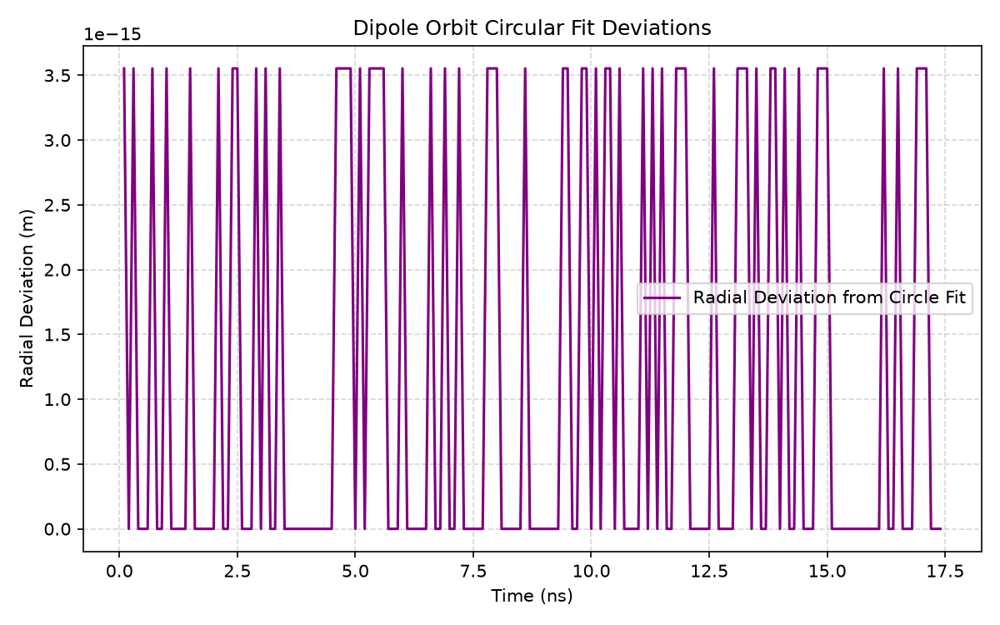
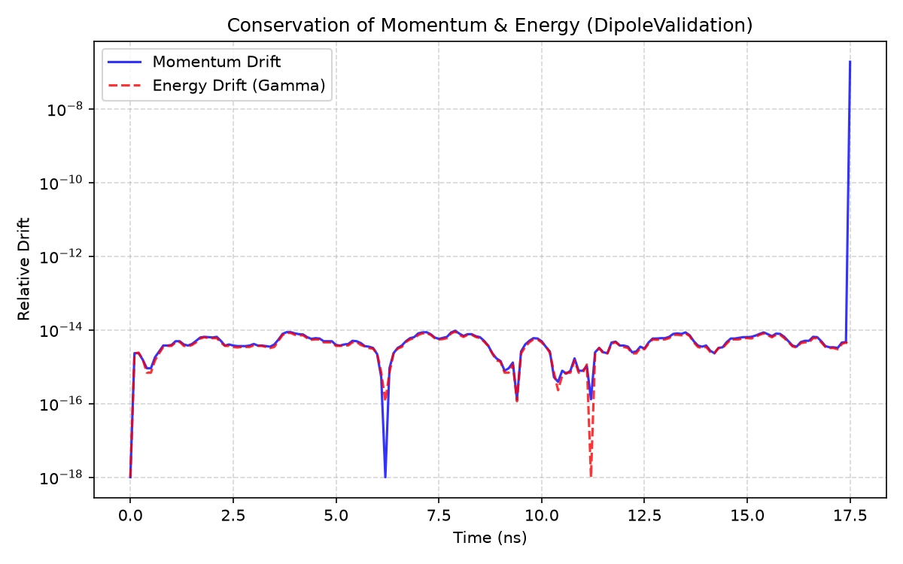

**Interpretation.** Sub-$10^{-6}$ radius error and machine-precision conservation demonstrate that magnetic transport is implemented correctly: the particle follows the expected Lorentz curvature without numerical energy exchange. Agreement of the bend angle within tolerance confirms that integrated deflection through a finite magnet length matches rigidity physics.

---

## Quadrupole

**Physical quantity.** Linear focusing / defocusing under $B_x=Gy$, $B_y=Gx$.

**Expectation.** Transverse motion oscillates or grows according to the signed focusing strength $\alpha=qG/B\rho$. Static magnetic fields conserve $|p|$ and $\gamma$. A paraxial analytical reference provides the expected $(x,y)$ evolution for comparison.

**Methodology.** A single antiproton is tracked through a focusing quadrupole. Coordinate errors relative to the paraxial solution, plus conservation metrics, are evaluated.

**Results.**

| Quantity | Result | Criterion |
|----------|--------|-----------|
| $x$ error | $4.3\times10^{-9}\,\mathrm{m}$ | $\le 10^{-6}\,\mathrm{m}$ |
| $y$ error | $1.0\times10^{-9}\,\mathrm{m}$ | $\le 10^{-6}\,\mathrm{m}$ |
| $z$ error | $2.5\times10^{-11}\,\mathrm{m}$ | $\le 10^{-6}\,\mathrm{m}$ |
| Momentum conservation | $3.3\times10^{-12}$ | $\le 10^{-6}$ |
| Energy conservation | $1.4\times10^{-12}$ | $\le 10^{-6}$ |

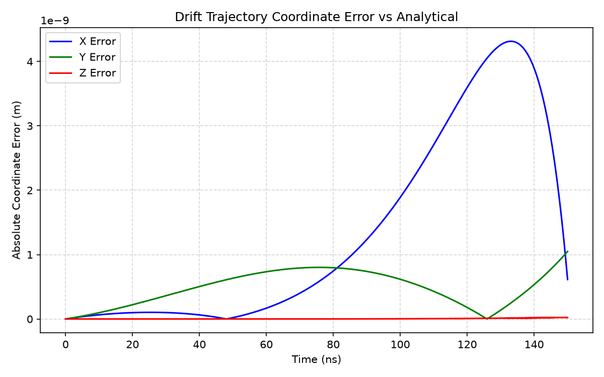
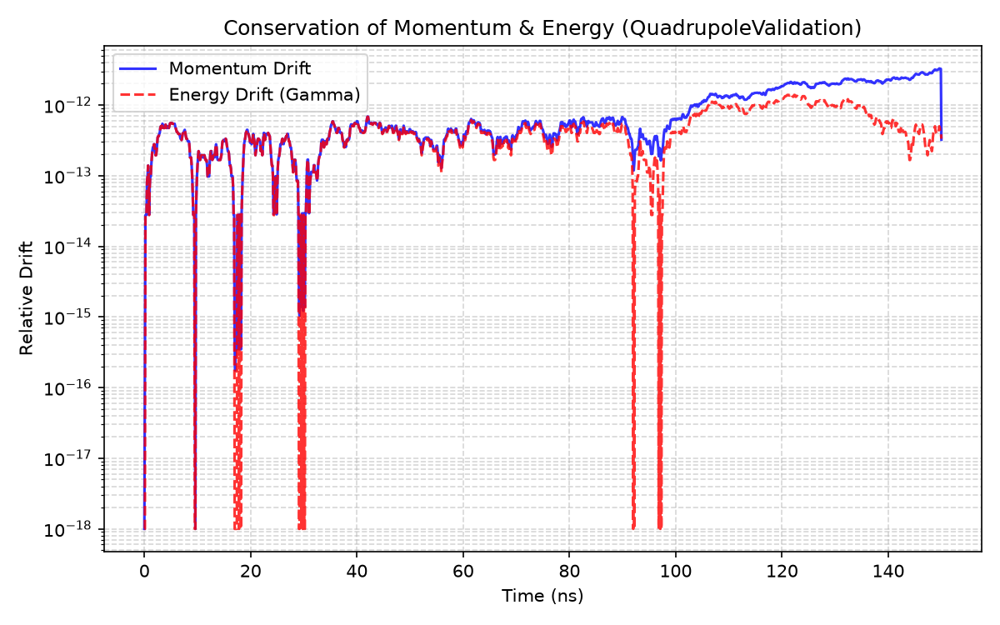

**Interpretation.** Nanometre-scale deviations from the paraxial reference are consistent with full three-dimensional Boris integration (finite $v_x$, $v_y$, and hard-edge entry), not with a broken field model. Conservation at $10^{-12}$ shows that the quadrupole applies focusing forces without numerical heating.

---

## Magnetic Horn

**Physical quantity.** Azimuthal focusing field and the induced radial momentum kick $\Delta p_r$ as a function of radius.

**Expectation.** An ideal thin horn carries an axial current $I$ and produces

$$
B_\varphi=\frac{\mu_0 I}{2\pi r}.
$$

The integrated radial kick then scales as $\Delta p_r\propto 1/r$, so the product $\Delta p_r\cdot r$ is constant. Static magnetic transport still conserves $|p|$ and $\gamma$.

**Methodology.** A single particle is tracked through a magnetic horn. The radial momentum change is compared to the analytical kick from $B_\varphi(r)$. A radius sweep checks that $\Delta p_r$ versus $1/r$ is linear and that $\Delta p_r\cdot r$ is constant within tolerance. Conservation is monitored as for other single-element cases.

**Results.**

| Quantity | Result | Criterion |
|----------|--------|-----------|
| Radial momentum kick error | $1.2\times10^{-2}$ | $\le 5\times10^{-2}$ |
| $\Delta p_r$ vs $1/r$ residual | $6.2\times10^{-4}$ | $\le 5\times10^{-2}$ |
| Momentum conservation | $1.4\times10^{-13}$ | $\le 10^{-6}$ |
| Energy conservation | $1.4\times10^{-13}$ | $\le 10^{-6}$ |

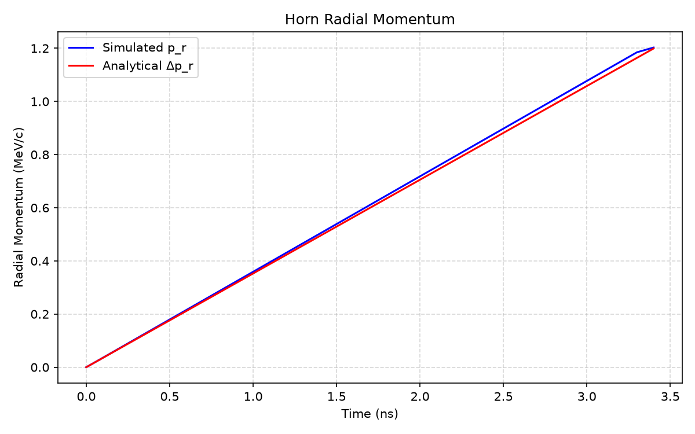
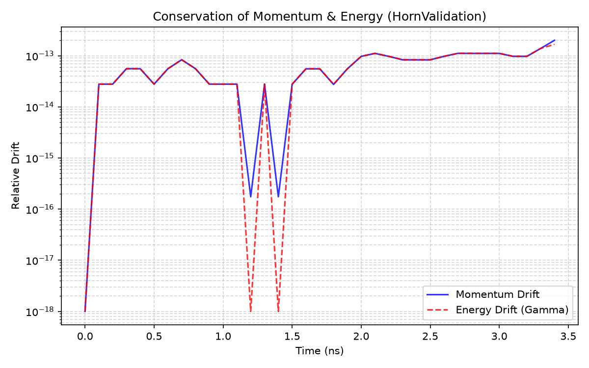
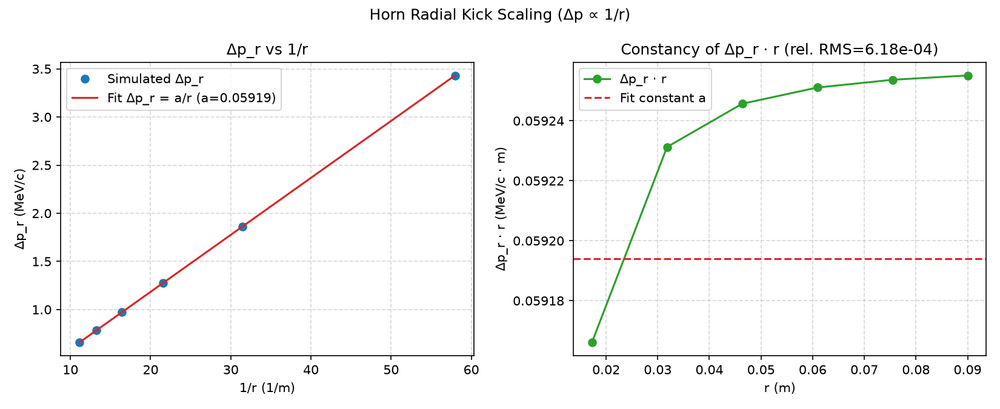

**Interpretation.** Agreement of the radial kick and the $1/r$ scaling confirms that the horn field and its Lorentz deflection are implemented correctly — the characteristic collector optic of antiproton production lines. Conservation at $10^{-13}$ shows that the azimuthal $B$ field does not inject numerical energy exchange.

**Chapter conclusion.** Drift, dipole, quadrupole, and magnetic horn single-particle transport are validated. The integrator and elementary magnetic elements form a trustworthy base for composite lattices.

---

# 3. Composite Lattice Validation

**Goal.** Demonstrate that validated elements remain physically consistent when combined: field transitions, interface continuity, and invariants survive element handoffs.

Composite lattices generally lack a single closed-form trajectory reference. Validation therefore shifts from orbit matching to **beam-quality metrics** on finite ensembles (Gaussian beams), while conservation remains a hard pass criterion.

---

## Drift → Dipole

**Physical quantity.** Continuity of transport through a field-free region into a uniform bend, including envelope response and conservation across the interface.

**Expectation.** Conservation of $|p|$ and $\gamma$ must persist through the handoff. The RMS envelope should evolve smoothly; vertical geometric emittance should remain approximately conserved. Horizontal emittance is **informational** in dipole lattices because dispersion couples energy and $x$.

**Methodology.** A 50-particle Gaussian beam traverses a 5 m drift followed by a 10 m dipole ($B_y=0.5\,\mathrm{T}$). Conservation, exit-state composition, envelope, and emittance drift are recorded.

**Results.**

| Quantity | Result | Criterion |
|----------|--------|-----------|
| Momentum conservation | $5.7\times10^{-9}$ | $\le 10^{-6}$ |
| Energy conservation | $2.7\times10^{-12}$ | $\le 10^{-6}$ |
| Transmission | $100\%$ | $\ge 95\%$ |
| Vertical $\varepsilon$ drift | $1.0\times10^{-2}$ | $\le 0.05$ |

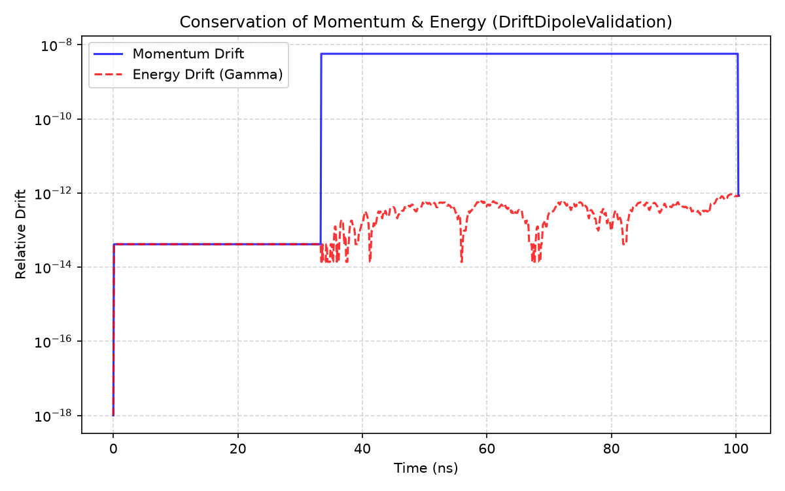
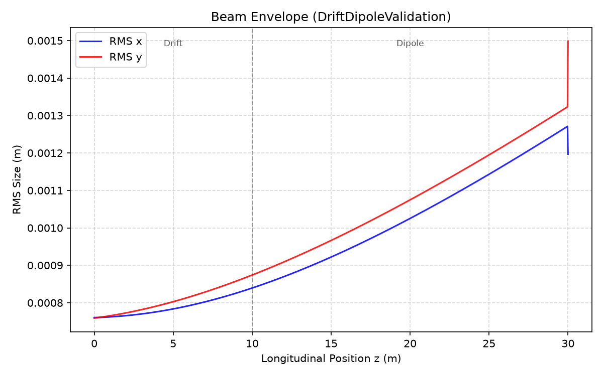

**Interpretation.** Conservation remains within tolerance across the drift–bend interface, indicating no discontinuous force artefact at the element boundary. The envelope responds to the onset of bending without numerical disruption. Bounded vertical emittance confirms that phase-space area in the non-dispersive plane is preserved through the composite.

---

## Drift → Quadrupole

**Physical quantity.** Composition of free drift with linear focusing; both transverse emittances should be conserved in the absence of dispersion.

**Expectation.** Focusing compresses one transverse plane; emittance in both planes should exhibit negligible secular drift; conservation must remain at integrator precision.

**Methodology.** A Gaussian beam traverses a 2 m drift and a 1 m quadrupole. Conservation, envelope, and relative emittance drift are evaluated in both planes.

**Results.**

| Quantity | Result | Criterion |
|----------|--------|-----------|
| Momentum conservation | $2.3\times10^{-12}$ | $\le 10^{-6}$ |
| Energy conservation | $2.2\times10^{-12}$ | $\le 10^{-6}$ |
| Horizontal $\varepsilon$ drift | $5.8\times10^{-7}$ | $\le 0.05$ |
| Vertical $\varepsilon$ drift | $5.1\times10^{-7}$ | $\le 0.05$ |
| Transmission | $100\%$ | $\ge 95\%$ |

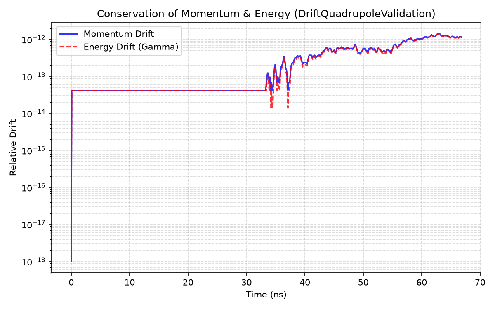
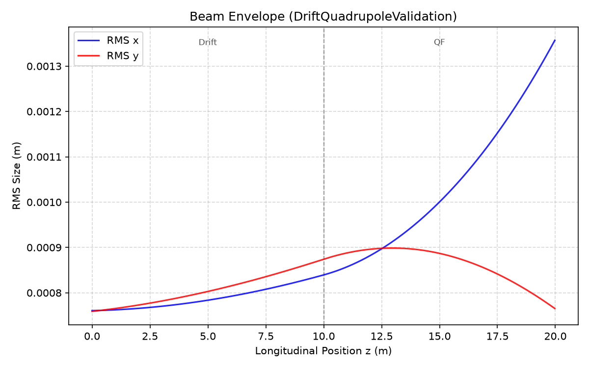

**Interpretation.** Emittance drifts at the $10^{-7}$ level show that joining a drift to a quadrupole does not inject artificial phase-space dilution. Envelope evolution matches the expected focusing response. This is the minimal successful composition test before alternating-gradient cells.

**Chapter conclusion.** Composite transport preserves conservation and beam quality across element interfaces. That intermediate stage is essential: multi-cell lattices only make sense once handoffs are trusted.

---

# 4. Beam Dynamics Validation

**Goal.** Shift from individual orbits to ensemble evolution under multi-element beamlines, and verify that beam observables obey linear optics and Liouville expectations.

In ideal linear Hamiltonian transport, particle trajectories rearrange in phase space while the occupied area — the geometric emittance — remains conserved (Liouville's theorem in the transverse plane). Envelope, divergence, and Twiss parameters may oscillate; emittance should not secularly grow.

Representative diagnostics below use the FODO beam-optics validation case (Gaussian antiproton beam, alternating QF/QD cells). The same beam-optics profile is also applied to a **minimal ACOL-inspired pipeline**: an injection drift followed by FODO cells, approximating the first stage of a collector-style beamline. That case is a deliberate step toward a digital twin of the antimatter factory transport chain at CERN — not a full factory model, but a validated multi-cell precursor on which more complete lattices can build.

---

## Beam envelope

**Physical quantity.** Transverse RMS sizes $\sigma_x(z)$ and $\sigma_y(z)$.

**Expectation.** Alternating-gradient focusing produces oscillatory envelopes: each quadrupole compresses one plane and expands the other.

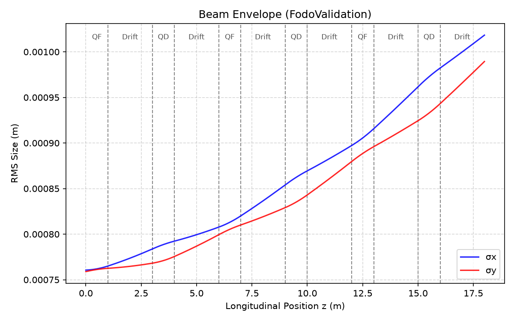

**Interpretation.** The measured envelopes show the classic FODO breathing pattern synchronized with QF/QD boundaries. Smooth evolution without abrupt jumps indicates correct field sampling through the lattice.

---

## Beam RMS size

**Physical quantity.** $\mathrm{RMS}(x)$, $\mathrm{RMS}(y)$, and $\mathrm{RMS}(z)$ versus longitudinal position.

**Expectation.** Transverse RMS tracks the envelope; longitudinal RMS reflects the bunch's $z$ spread and should not be driven by static magnetic optics.

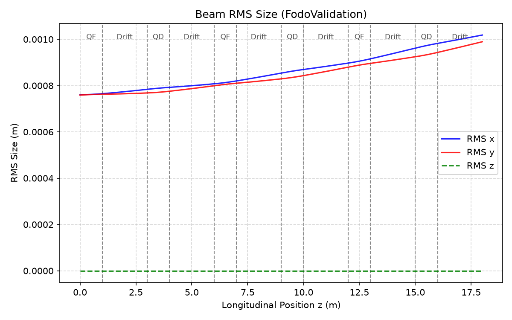

**Interpretation.** Transverse RMS mirrors the envelope diagnostic. Longitudinal RMS remains a separate degree of freedom, confirming that the diagnostics distinguish planes correctly.

---

## RMS divergence

**Physical quantity.** $\mathrm{RMS}(x')$ and $\mathrm{RMS}(y')$ with $x'=p_x/p_z$.

**Expectation.** Divergence oscillates in antiphase with the envelope in each plane: a waist coincides with large angular spread.

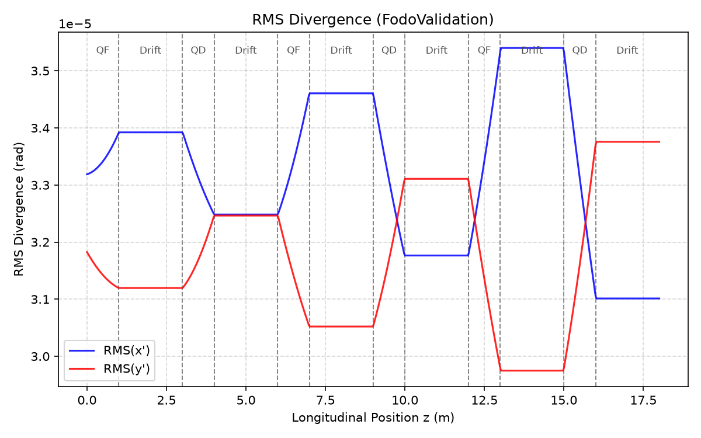

**Interpretation.** The complementary oscillation of size and divergence is the phase-space signature of linear focusing, not of numerical diffusion.

---

## Phase-space evolution

**Physical quantity.** Transverse phase portraits $(x,x')$, $(y,y')$, and $(x,y)$ at lattice entrance and exit.

**Expectation.** Linear transport shears and rotates the distribution; the occupied area should remain comparable if emittance is conserved.

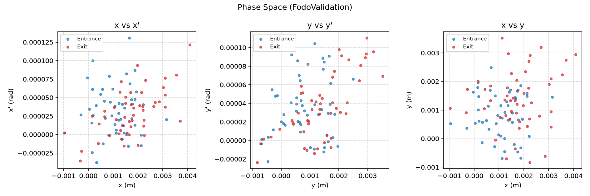

**Interpretation.** Entrance and exit clouds show the expected remapping under FODO transport. The distributions remain compact and elliptical, consistent with linear optics rather than filamentation from broken fields.

---

## Geometric emittance

**Physical quantity.** Horizontal and vertical RMS geometric emittances $\varepsilon_x$, $\varepsilon_y$, and their relative drift $(\varepsilon-\varepsilon_0)/\varepsilon_0$.

**Expectation.** Under ideal linear magnetic optics, $\varepsilon$ is an invariant of the ensemble (Liouville). Relative drift should remain far below the 5% pass threshold.

| Quantity | Result | Criterion |
|----------|--------|-----------|
| Horizontal $\varepsilon$ drift | $1.6\times10^{-10}$ | $\le 0.05$ |
| Vertical $\varepsilon$ drift | $2.5\times10^{-11}$ | $\le 0.05$ |

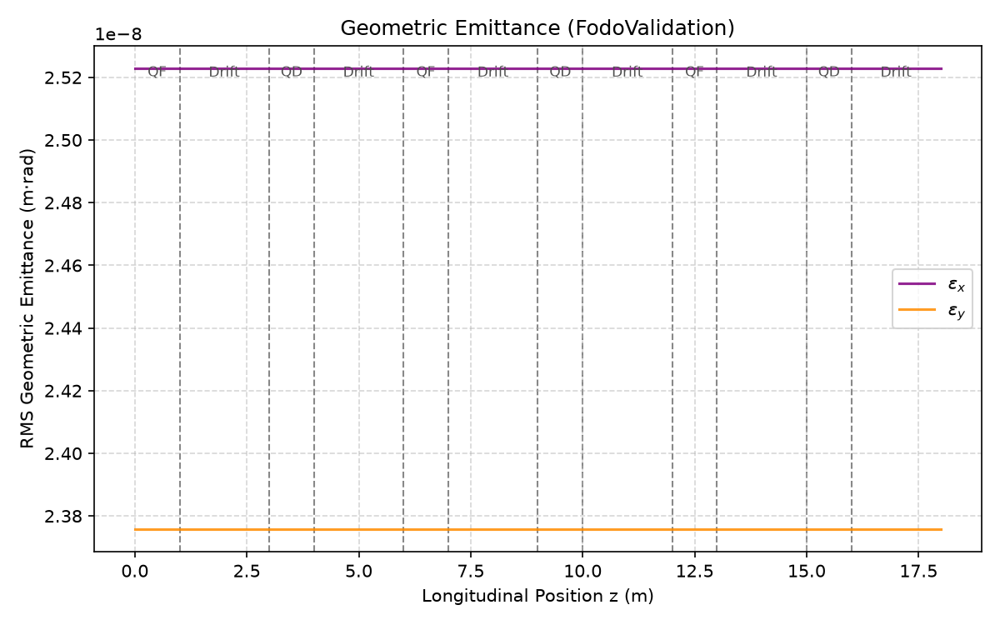
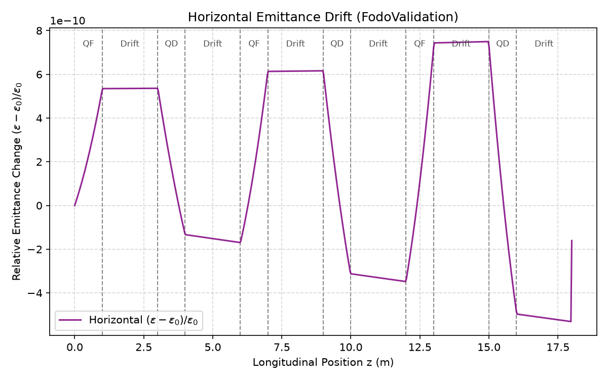

**Interpretation.** Absolute emittance is stable along the lattice; relative drift is consistent with zero within numerical noise. This is direct evidence that Janus preserves transverse phase-space area in multi-element transport.

---

## Momentum spread

**Physical quantity.** Ensemble $\Delta p/p$ (mean and RMS) and entrance/exit histograms.

**Expectation.** Static magnetic fields do not change $|p|$ particle-by-particle; the momentum distribution should be preserved.

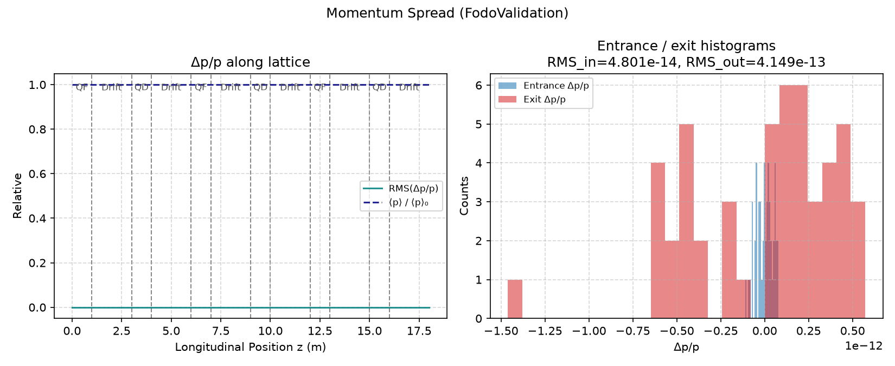

**Interpretation.** Flat $\Delta p/p$ along $z$ and overlapping entrance/exit histograms confirm that magnetic transport does not alter the rigidity distribution — a prerequisite for trustworthy optics comparisons.

---

## Transmission

**Physical quantity.** $N_\mathrm{alive}/N_\mathrm{initial}$ through the lattice.

**Expectation.** For apertures large compared with the beam, transmission should remain unity.

| Quantity | Result | Criterion |
|----------|--------|-----------|
| Transmission | $100\%$ | $\ge 95\%$ |
| Particle loss | $0\%$ | $\le 5\%$ |

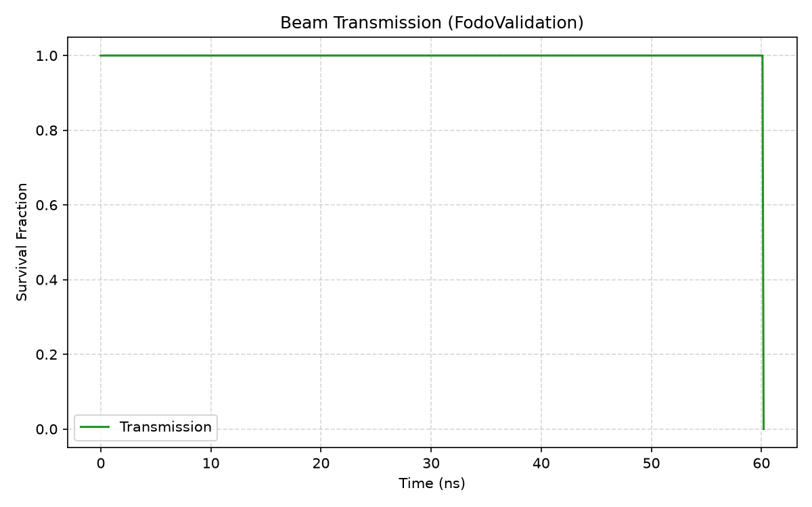

**Interpretation.** Full transmission shows that the FODO optics keep the beam within acceptance for this configuration; no unphysical aperture clipping is introduced by the integrator.

---

## Acceptance / losses

**Physical quantity.** Per-element loss counts and cumulative transmission.

**Expectation.** With 100% transmission, per-element losses should be zero; cumulative transmission remains flat at unity.

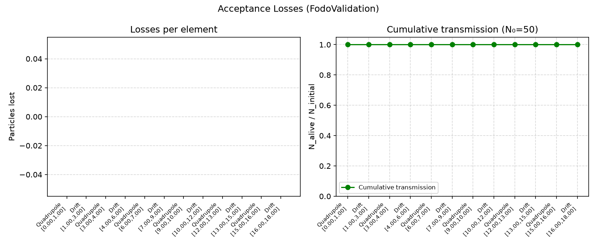

**Interpretation.** Empty loss histograms localize no deaths to any magnet or drift. When losses do occur in tighter apertures, the same diagnostic attributes them to the responsible element — an acceptance map for future beamline design.

---

# 5. Linear Optics Benchmarking

**Goal.** Compare Janus beam transport against an established first-order optics description.

Janus provides a modular optics backend: a built-in thick-lens linear model (Drift / Quadrupole matrices) is the default comparison target, designed to be replaceable by MAD-X via `cpymad` when available. Agreement at first order shows that particle tracking reproduces the same linear map that accelerator codes use for lattice design.

Deviations at the level of finite beam size, higher-order kinematics, and discrete timestepping are expected; the claim is consistency within numerical accuracy, not identical floating-point output.

---

## Transfer matrix comparison

**Physical quantity.** The $4\times4$ transverse transfer matrix $R=\partial X_f/\partial X_i$ with $X=(x,x',y,y')$.

**Methodology.** $R$ is estimated from tracked entrance/exit phase space by ensemble least squares and compared to the linear-optics backend. The metric is the relative Frobenius error $\|R_\mathrm{Janus}-R_\mathrm{ref}\|_F/\|R_\mathrm{ref}\|_F$.

| Quantity | Result |
|----------|--------|
| Relative Frobenius error | $4.7\times10^{-4}$ |

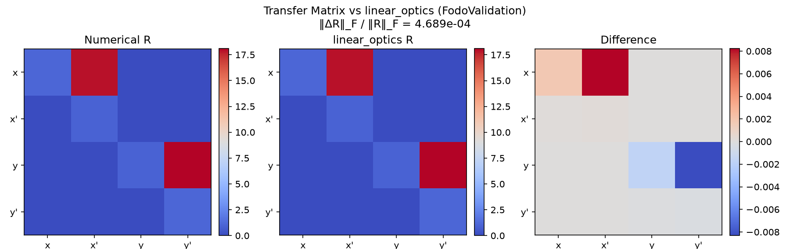

**Interpretation.** Sub-permille matrix agreement shows that the tracked linear map matches thick-lens optics for the FODO cell. Residual differences are consistent with finite emittance sampling and relativistic kinematics beyond the paraxial matrix model.

---

## Beam envelope comparison

**Physical quantity.** $\sigma_x(z)$ and $\sigma_y(z)$ from tracking versus linear propagation of the entrance covariance.

| Quantity | Result |
|----------|--------|
| Envelope RMS difference | $4.9\times10^{-5}\,\mathrm{m}$ |

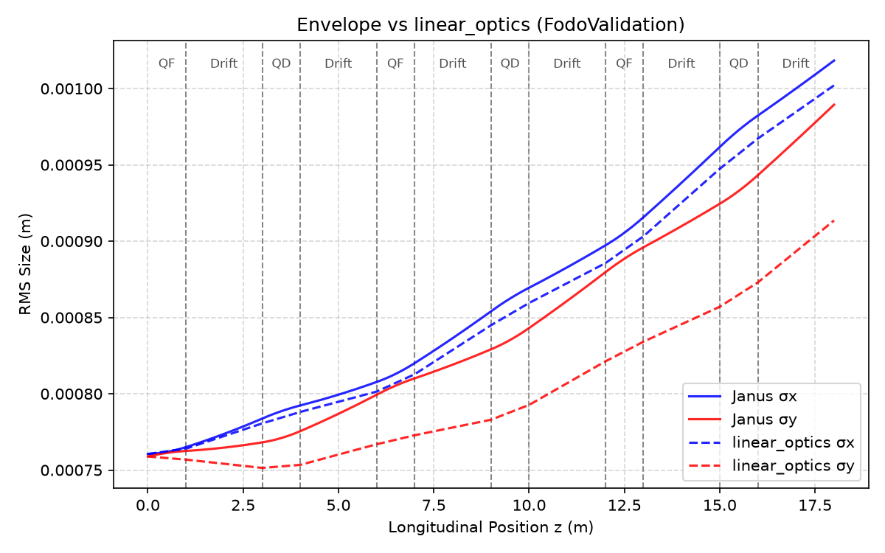

**Interpretation.** Overlay of Janus and linear-optics envelopes confirms that collective beam size follows first-order transport. Small offsets reflect the difference between a full distribution and an uncoupled linear covariance model, not a failure of focusing.

---

## Twiss parameter comparison

**Physical quantity.** Courant–Snyder parameters $\beta_{x,y}(z)$, $\alpha_{x,y}(z)$, $\gamma_{x,y}(z)$ from the tracked RMS covariance, compared to the optics backend.

**Expectation.** In linear optics, $\beta$, $\alpha$, and $\gamma$ evolve deterministically from the entrance conditions; Janus Twiss extracted from the particle cloud should track the same curves.

| Family | RMS relative error (FODO) |
|--------|---------------------------|
| $\beta$ | $1.7\times10^{-3}$ |
| $\alpha$ | $7.1\times10^{-3}$ |
| $\gamma$ | $4.3\times10^{-3}$ |

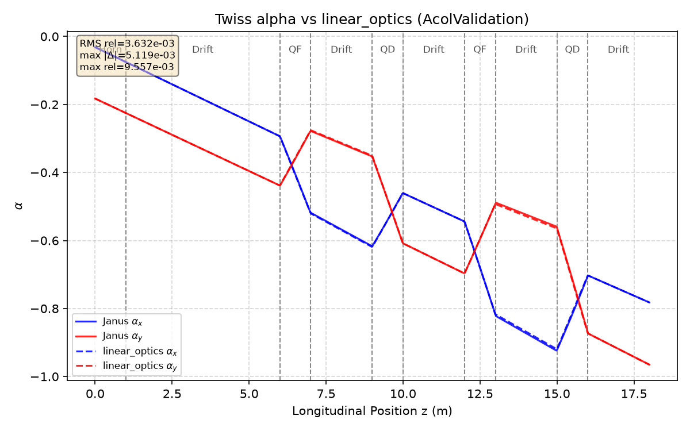
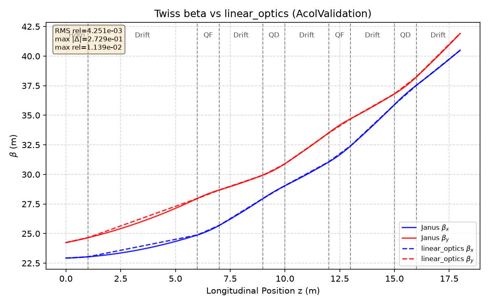
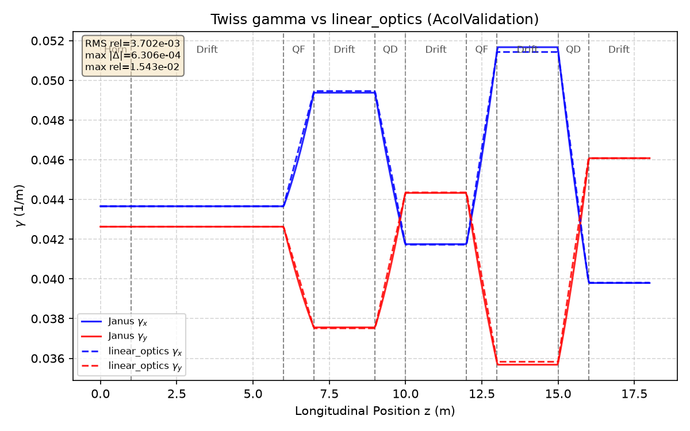

**Interpretation.** $\alpha(z)$, $\beta(z)$, $\gamma(z)$ exhibit the periodic FODO modulation expected of matched alternating-gradient transport. Overlay with the linear backend at the $10^{-3}$ relative level validates that ensemble Twiss extraction and matrix optics describe the same lattice.

**Chapter conclusion.** First-order transfer maps, envelopes, and Twiss functions from Janus tracking agree with established linear beam optics within expected numerical accuracy. The comparison interface is backend-agnostic and ready for MAD-X when deployed.

---

# 6. Conservation Summary

Across the validation hierarchy, the same invariants are monitored so that complexity does not hide integrator failure.

| System | Momentum drift | Energy drift | $\varepsilon$ drift (non-dispersive) |
|--------|----------------|--------------|--------------------------------------|
| Drift | $0$ | $0$ | — |
| Dipole | $9.5\times10^{-15}$ | $8.9\times10^{-15}$ | — |
| Quadrupole | $3.3\times10^{-12}$ | $1.4\times10^{-12}$ | — |
| Magnetic horn | $1.4\times10^{-13}$ | $1.4\times10^{-13}$ | — |
| Drift → Dipole | $5.7\times10^{-9}$ | $2.7\times10^{-12}$ | $1.0\times10^{-2}$ (vertical) |
| Drift → Quadrupole | $2.3\times10^{-12}$ | $2.2\times10^{-12}$ | $\sim5\times10^{-7}$ |
| FODO | $2.0\times10^{-12}$ | $1.9\times10^{-12}$  | $\sim10^{-10}$ |
| ACOL | $1.2\times10^{-12}$ | $1.2\times10^{-12}$  | $\sim10^{-10}$ |

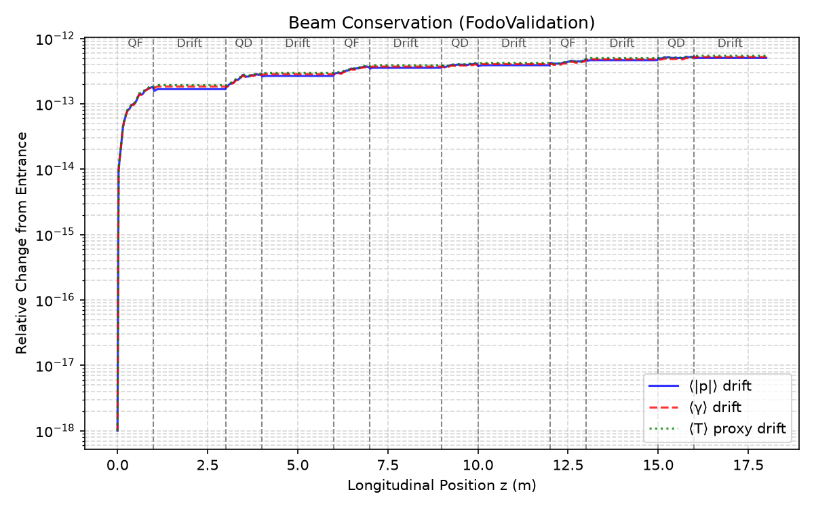

**Interpretation.** Relative drifts remain at or below the $10^{-6}$ verification threshold from single magnets through multi-cell beamlines. Emittance is preserved wherever dispersion is absent. Transmission stays complete for the validated apertures. Conservation therefore holds as system complexity increases — the necessary condition for trusting subsequent design studies.

---

# 7. Validation Scope and Current Limitations

## Validated

- Relativistic charged-particle motion under the Boris integrator
- Static magnetic lattice elements: drift, uniform dipole, linear quadrupole, magnetic horn (including $\Delta p_r\propto 1/r$ kick scaling)
- Composite handoffs and multi-cell FODO / minimal ACOL-inspired beamlines

- Ensemble beam diagnostics (envelope, emittance, divergence, transmission, losses)
- First-order optics consistency (transfer matrix, envelope, Twiss) against the modular linear backend

## Current modelling assumptions

- Static magnetic fields (no RF acceleration in these studies)
- Ideal hard-edge magnets
- Relativistic single-particle and ensemble transport without collective fields
- First-order (linear) beam optics for external comparison

## Outside the present scope

The following are **future extensions**, not present failures of the validated core:

- Space charge
- Scattering and material interactions
- Synchrotron radiation
- Nonlinear magnets (sextupoles, octupoles, fringe-field maps)
- Stochastic cooling and electron cooling
- Trapping and deceleration stages

Each can build on the hierarchy established here once corresponding references and diagnostics are added.

---

# 8. Conclusions

Validation of Janus transport follows a single chain of evidence:

```text
Single-particle physics
        ↓
Composite lattice transport
        ↓
Beam dynamics
        ↓
Linear optics benchmarking
```

1. **Single-particle physics.** Drift, dipole, quadrupole, and magnetic horn trajectories — including horn radial-kick scaling — certify the Lorentz force and Boris integrator.
2. **Composite lattice transport.** Drift–dipole and drift–quadrupole assemblies preserve invariants across interfaces.
3. **Beam dynamics.** FODO ensembles exhibit the expected envelope, divergence, phase-space, emittance, momentum-spread, and transmission behaviour, consistent with Liouville's theorem in linear optics. The minimal ACOL-inspired pipeline extends the same diagnostics to a collector-style multi-cell layout as an early digital-twin stepping stone for CERN antimatter transport.
4. **Linear optics benchmarking.** Transfer matrices, envelopes, and Twiss parameters agree with established first-order optics within numerical accuracy.

Together these results establish a reliable computational foundation for future optimization and for extension toward complete antimatter transport, deceleration, cooling, trapping, and ultimately a digital twin of the antimatter factory transport pipeline.

---
